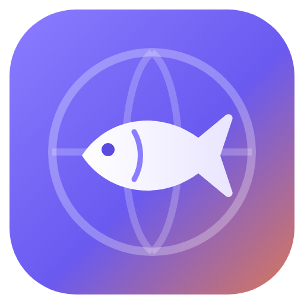

<div align="center">



# MojarraNav

**El navegador web de Mojarrium, con Claude navegando contigo.**
Pregúntale por la página que estás viendo, pídele que busque, compare o abra pestañas por ti.


</div>

---

> *"Resume esta página y busca dos reseñas que digan lo contrario."*
>
> Escríbelo en el panel de Claude: lee la pestaña, busca y te abre lo que encuentre.

## ✨ Características

- **Pestañas** con arrastrar para reordenar, clic central para cerrar, silenciar sitios y reabrir la última cerrada.
- **Barra de direcciones inteligente**: escribe una dirección o una búsqueda; sugiere tus favoritos y lo más visitado.
- **Favoritos, historial y descargas** en páginas propias (`moja://favoritos`, `moja://historial`, `moja://descargas`).
- **Buscar en la página**, zoom, imprimir, guardar página, pantalla completa y herramientas de desarrollador.
- **Permisos bajo control**: cámara, micrófono, ubicación o notificaciones siempre se preguntan.
- **Páginas de error en español** que explican qué pasó.
- **Restaura tus pestañas** al volver a abrir.

### 🤖 Claude dentro del navegador
- Panel lateral con el mismo chat que MojarraCut: elige **modelo** y **esfuerzo**, adjunta imágenes o una **captura de la página**.
- Claude puede **leer la pestaña**, ver enlaces, **abrir y cerrar pestañas**, **buscar**, resaltar texto y guardar favoritos.
- Clic derecho sobre un texto → **Preguntar a Claude** o **Traducir**. Clic derecho en la página → **Resumir**.
- Seguro por diseño: Claude **no puede ejecutar comandos ni editar archivos**; solo usa las herramientas del navegador,
  buscar/leer en la web y leer la carpeta de datos. Lo que dice una página se trata como información, nunca como órdenes.

## ⌨️ Atajos

| Atajo | Acción | Atajo | Acción |
|---|---|---|---|
| `Ctrl+T` | Pestaña nueva | `Ctrl+W` | Cerrar pestaña |
| `Ctrl+Shift+T` | Reabrir pestaña cerrada | `Ctrl+Tab` / `Ctrl+1…9` | Cambiar de pestaña |
| `Ctrl+L` / `F6` | Ir a la barra de direcciones | `Ctrl+F` / `F3` | Buscar en la página |
| `Ctrl+D` | Favorito | `Ctrl+H` / `Ctrl+J` | Historial / Descargas |
| `Ctrl+Shift+L` | Panel de Claude | `Ctrl + / - / 0` | Zoom |
| `Alt+←` / `Alt+→` | Atrás / Adelante | `F5` / `Ctrl+Shift+R` | Recargar / sin caché |
| `F11` | Pantalla completa | `F12` | Herramientas de desarrollador |

## 📦 Instalación

Requiere Windows 10/11. Para el panel de Claude, instala la [app de Claude](https://claude.com/download)
(incluye Claude Code) e inicia sesión; MojarraNav la encuentra sola.

```bash
npm install
npm start          # abre el navegador
npm test           # pruebas de extremo a extremo → tests/reporte.md
npm run dist       # instalador de Windows en dist/
```

## 🗂️ Tus datos

Todo se guarda en `Documentos\MojarraNav\` en archivos JSON legibles:
`favoritos.json`, `historial.json`, `ajustes.json`, `sesion.json` y `chat.json`.
Las cookies y la caché de los sitios viven en el perfil de la app (se borran desde `moja://ajustes`).

## 🛠️ Cómo está hecho

| Archivo | Qué hace |
|---|---|
| `main.js` | Ventana, pestañas (`WebContentsView`), atajos, menús, permisos, descargas y páginas `moja://` |
| `ui/` | Interfaz: pestañas, barra de direcciones y panel de Claude (HTML/CSS/JS sin frameworks) |
| `paginas/` | Páginas internas: inicio, historial, favoritos, descargas, configuración y error |
| `claude.js` | Lanza `claude -p` en streaming (igual que MojarraCut) con permisos limitados |
| `mcp.js` + `puente.js` | Servidor MCP propio que da a Claude las herramientas del navegador, vía un puente local con token |
| `datos.js` | Favoritos, historial, ajustes y sesión en `Documentos\MojarraNav\` |
| `marca.js` | Nombre de la app en un solo lugar |

Parte de **Mojarrium**, junto a [MojarraCut](https://github.com/MilioGa/MojarraCut).
